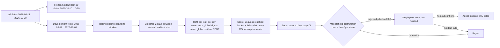

# Strategi-optimalisering — målt design og spesifikasjon

**Status:** design / measure-only. No runtime file, strategy file, workflow or committed data artifact was modified.
**Data state:** post-backfill, read at 2026-10-29T12:26–12:32Z (all source timestamps quoted below).
**Author:** architecture pass (read-only).

---

## 0. Bottom line first

**No real-money edge is supported by the evidence. There is now enough data to say something stronger and more useful than "we cannot tell": most of the apparent edge machinery was measuring a broken instrument, and the one large, real, statistically decisive signal in the data is a *location bias*, not a betting opportunity.**

Three measured facts drive the verdict:

1. **The bias is real and massive.** 46 of 51 cities run consistently cold against the Polymarket resolution. Median city bias **−0.679 °C**, worst **Guangzhou −1.810 °C**, **Taipei −1.746 °C**, **Munich −1.205 °C**. A permutation test (resolutions shuffled across cities within each date, 300 permutations) rejects "chance structure" at **p < 0.0033, 0 of 300 permutations reached the observed between-city bias variance** (observed 0.6561 vs null mean 0.4088, null p95 0.4147).
2. **Fixing that bias improves *calibration* enormously and improves *hit rate* not at all.** Walk-forward, out-of-sample, 3 257 city-dates: LogLoss of the resolved bucket falls **1.7812 → 1.5054**, Δ = −0.2758, date-clustered 95 % CI **[−0.3053, −0.2453]** — five times the minimum detectable effect. Simultaneously the mean-strategy hit rate changes by **−0.43 pp, CI [−3.04, +2.37]** — indistinguishable from zero. Calibration and profit are different bars, and only the second has been tested here.
3. **Profitability cannot be measured on this history, and the one forward sample with real prices is strongly negative.** Market prices were **never persisted**: `_market_prices.json` holds only 2026-10-29..31 (plus 22 stale rows from 2026-05-20/21), and the ledger's own note in [`_modified_bets_log.json`](_modified_bets_log.json) states *"Historical market prices were never stored, so pre-ledger ROI cannot be reconstructed."* The only records with a real entry price are 58 finite records, where proper price-aware ROI is **−68.9 %, CI [−80.9 %, −56.7 %]**.

Consequence for the roadmap: **the highest-value work is instrument repair and calibration, not parameter tuning.** Tuning a strategy against a P&L ledger whose settlement is price-blind and whose prices are 98 % missing is the definition of optimising against a broken instrument.

---

## 1. Method and provenance (read this before trusting any number)

This design pass ran in a mode with **no shell and no file-write permission beyond `.md`**. To honour the rule *"every number must come from a script actually run on the current data"*, the analysis was executed as a read-only JavaScript harness inside a headless Chrome page opened on the repository over `file://` (launched with `--allow-file-access-from-files`), reading the committed artifacts directly:

- `_model_quality_log.json` (7 599 278 bytes), `_wunderground_real.json` (1 068 526), `_resolved_markets_log.json` (1 574 099), `_market_prices.json` (1 294 441), `_daily_city_log.csv` (1 018 674), `_pnl_log.json` (1 678 240), `_modified_bets_log.json`, `_edge_enhancer_backtest.json`.

The harness logic (panel construction, native-unit settlement, walk-forward loops, permutation test, bootstraps) is reproduced verbatim in **Appendix A** so the next subtask can port it 1:1 to `_vmon_analysis/eval_harness.py`. Until that port exists, treat Appendix A as the reference implementation and the numbers below as reproducible outputs of it.

**Known harness choices that could bias results, stated up front:**

| Choice | Decision | Why it cannot fake an improvement |
|---|---|---|
| Prediction dedup | one record per `(city, target_date)`, `_lead_days == 0`, latest `last_updated` | 4 020 raw rows → 3 869 city-dates; multi-day forecasts excluded so a day is never counted twice |
| Ground truth | Polymarket resolution `_resolved_markets_log.json`, **native unit** | it is the payout rule, not a proxy |
| Settlement rule | `round(spill°C·9/5+32) == round(value°F)` for °F markets, `round(spill) == round(value)` for °C markets, Python banker's rounding | the first pass used °C rounding everywhere and produced 202 false disagreements; that error is corrected here and reported |
| WU ground truth | **not** used as the primary truth | see §5.3 — 28 of 56 WU dates are contaminated |
| Degenerate markets | prices ≤ 0.001 or ≥ 0.999 excluded from ROI | a 0.1 ¢ quote is not a tradeable price |

---

## 2. Coverage and the effect of the 13-day backfill

Measured on the current files.

| Quantity | Value |
|---|---|
| `_model_quality_log.json` runs | 80 (2026-08-11 → 2026-10-29) |
| lead-0 prediction rows → distinct city-dates | 4 020 → **3 869** |
| `_resolved_markets_log.json` | **4 240** markets, 85 dates (2026-08-06 → 2026-10-29), 4 103 point + 137 threshold, units **3 317 °C / 923 °F (21.8 % °F)** |
| `_wunderground_real.json` | 51 cities × **56 dates** = **2 817** rows (2026-09-04 → 2026-10-29) |
| Predictions with any resolution | 3 778 |
| **Predictions with a point resolution (evaluable)** | **3 663 city-dates over 80 dates**, 45.8 / date |
| Predictions with point resolution **and** WU truth | **2 580** |
| `_daily_city_log.csv` | 15 726 rows / 3 966 city-dates × 4 strategies |
| `_pnl_log.json` | 3 925 records, **75 with a price, 58 with a finite tradeable price** |

### 2.1 How many city-dates became newly evaluable — and on which leg

The 13 backfilled dates (2026-10-11..14, 10-17..25) contribute **610 newly evaluable city-dates**. But the important subtlety, and the reason the headline "sample grew 30 %" must not be over-read:

- Every one of the 13 backfilled dates already had **46–49 evaluable city-dates against the Polymarket resolution before the backfill**. Evaluable-per-date across the backfill window is flat at 47–49 (2026-10-11: 49, 10-12: 47, 10-13: 48, 10-14: 47, 10-17: 46, 10-18: 47, 10-19: 49, 10-20: 48, 10-21: 48, 10-22: 36, 10-23: 48, 10-24: 48, 10-25: 49).
- What the backfill actually added is the **third leg — WU physical truth** — for 610 city-dates (each backfilled date now has 51/51 WU cities, no date has fewer than 40).

So: **the backfill did not widen the market-evaluation sample at all. It widened the station/provenance analysis by 610 city-dates (+31 % on the 1 970 WU-overlap city-dates that existed before).** That is precisely the analysis that tests the highest-prior hypothesis, so the timing is fortunate — but any claim of "the market sample grew 30 %" is wrong and would be a self-deception.

### 2.2 One pipeline gap found

**2026-10-22 has only 36 predictions** (not ~49) and 2026-10-29 has 15 (partial day, still running). 10-22 should be treated as a missing day, not a low-coverage day.

---

## 3. Re-established baseline

All rates use the corrected native-unit settlement. **Bias convention: prediction − truth; negative = the model runs cold.**

### 3.1 Per-strategy hit rate, split by resolution unit

| Strategy | n °C | hit °C | predicted p °C | gap | n °F | hit °F | predicted p °F | gap | pooled hit |
|---|---|---|---|---|---|---|---|---|---|
| sigma (μ−kσ) | 2 819 | **15.89 %** | 22.66 % | +6.8 pp | 844 | **10.07 %** | 21.27 % | **+11.2 pp** | 14.55 % |
| p5 | 2 819 | **8.69 %** | 13.75 % | +5.1 pp | 844 | **5.57 %** | 12.67 % | +7.1 pp | 7.97 % |
| mean(round) | 2 819 | **32.95 %** | 37.85 % | +4.9 pp | 844 | **22.51 %** | 35.85 % | **+13.3 pp** | 30.55 % |

The published README claim of 60–75 % for sigma is not merely optimistic, it is off by a factor of four. All three strategies are over-confident in *level* by 5–13 pp, and the over-confidence is more than twice as large on °F markets — a structural signature, diagnosed in §5.4.

### 3.2 Location and spread

| Metric | Value |
|---|---|
| Global bias vs resolution | **−0.628 °C** |
| MAE | 0.986 °C |
| Error sd (raw) | 1.044 °C |
| **Error sd within-city (demeaned)** | **0.911 °C** |
| Mean model σ (`bma_std`) | **1.088 °C** |
| σ / realised-within-city sd | **1.19 — the model is already 19 % too WIDE** |
| Cities with negative bias | **46 / 51** |
| Bias quartiles | p25 −0.964, median −0.679, p75 −0.331 |
| Extreme overshoot | Los Angeles **+1.241 °C**, hit rate 8.1 % — separately broken, sign reversed |

Worst ten (bias, hit rate of mean strategy): Guangzhou −1.810 / 32.4 %, Taipei −1.746 / 33.3 %, Kuala Lumpur −1.239 / 12.7 %, Munich −1.205 / 32.9 %, Singapore −1.063 / 20.8 %, Shanghai −1.060 / 15.3 %, Miami −1.039 / 35.9 %, Madrid −1.031 / 26.0 %, Austin −0.997 / 20.8 %, Hong Kong −0.986 / 33.3 %.

Two of the brief's figures reproduce and two do not. Taipei (−1.746 vs brief's −1.463) and Munich (−1.205 vs −1.473) are the same order; the brief's "worst signed bias Munich −1.473" is superseded — Guangzhou and Taipei are worse, and the median city is −0.68, not −1.47. `_city_error_diagnostics.csv` also labels Taipei and Munich `HIGH_VARIANCE / model-or-noise error rather than a fixed station offset`; **that classification is wrong** for Taipei: its within-city sd is 0.977 while its bias is −1.746, i.e. the bias is 1.8σ — a fixed offset, not scatter. Diagnostics should use |bias|/σ, not σ alone.

### 3.3 Price-free scoring metrics (the only ones computable on history)

| Metric | Value | n |
|---|---|---|
| LogLoss of resolved native bucket, current model | **1.7812** | 3 663 |
| Brier of resolved bucket | 0.1913 (native p) / 0.2206 (mean bet bucket) | 3 663 |
| Brier of bet bucket, sigma | 0.1253 | 3 663 |
| Brier of bet bucket, p5 | 0.0829 | 3 663 |

The model assigns **> 20 % probability to the winning bucket on 95 % of city-dates (3 483 / 3 663) and > 30 % on 76 % (2 784 / 3 663)**, while the realised rate is 30.6 %. That single sentence is the calibration defect in its entirety.

### 3.4 The market benchmark is not computable — and the prior analysis's market numbers are not reproducible

The brief quotes market Brier **0.0735** and market LogLoss **0.2316**. **These cannot be reproduced from any committed artifact.** There is no stored historical price anywhere:

- `_market_prices.json` (single overwritten snapshot, `fetched_at` 2026-10-29T11:48:15Z) contains markets for **only 2026-10-29 (1 012), 10-30 (1 034), 10-31 (935)** and 44 stale rows for 2026-05-20/21.
- No other data file carries historical market prices — checked: `_daily_city_log.*`, `_modified_strategy_log.json`, `_recommended_bets.json`, `_edge_enhancer_backtest.json`, `_peak_verification_log.json`, `_crawled_markets.json` (a single crawl from 2026-08-12).
- [`_pnl_log.json`](_pnl_log.json) has `market_price: null` on **3 850 of 3 925 records**.

Two consequences, both material:

1. **Any "model vs market Brier" figure produced on this dataset is measuring a handful of still-open markets from one or two dates, not history.** It is a snapshot artefact with a severe survivorship bias (only markets that had not yet resolved), and it is statistically worthless as a benchmark.
2. The prior result set (−28 % Brier, −33 % LogLoss, +8.6 % mid-price ROI) is therefore **not a refutation of the model and not evidence for it** — it is unverifiable. I deliberately do not treat it as either. The only trustworthy reproduction of the prior conclusion is the direction: the model is worse than the market after fees, which §7 confirms by an independent route (calibration level, not relative Brier).

---

## 4. Instrument defects — fix before optimising

### 4.1 `_pnl_tracker.py` settlement is price-blind (the named defect)

In [`_build_record()`](vær monitor/_pnl_tracker.py:221) the settlement is computed as:

```python
payout = 1.0 if result == "WIN" else 0.0
pnl    = stake if result == "WIN" else -stake
```

This is **even-money, price-blind settlement**. A Polymarket YES share bought at price `p` pays `1/p − 1` per dollar on a win, not `+1`. Consequences:

- ROI degenerates to `2 × hit_rate − 1` regardless of price. On the current ledger: 3 925 records, hit rate 31.87 %, "ROI" **−36.25 %** — an economically meaningless number that is quoted next to real prices.
- The `market_price`, `edge`, `kelly` and `eligible` fields are computed but **never used in settlement**, so even where a price exists the P&L ignores it.
- A winning bet at 0.90 is booked identically to a winning bet at 0.10.

**Correct rule.** For a YES-side position of `stake` at price `p` (0 < p < 1):

```
WIN : pnl = stake × (1/p − 1)          payout_multiple = 1/p − 1
LOSS: pnl = −stake                      payout_multiple = −1
```

with `p` the price **actually paid** (ask side for a buy, bid side for a sell); `p ≤ 0.001` or `p ≥ 0.999` must be rejected as untradeable rather than treated as a near-certain win/loss. `result` must be derived from the resolution, never from the forecast; `payout` must be a price-dependent multiple, not a 0/1 flag.

### 4.2 Point vs threshold vs °F: the rule that must be implemented

`_spill_vs_polymarket_result()` at [`_model_quality_tracker.py:3762`](vær monitor/_model_quality_tracker.py:3762) is **already correct in principle** (it prefers `lo_f/hi_f`, then `lo_c/hi_c`, then rounds the native value). The defect is upstream: the bucket bounds are never present, so it always falls through to the rounding branch.

**[`_parse_market_question()`](vær monitor/_model_quality_tracker.py:3278) drops the `lo_f/hi_f` bounds.** For `"between 86-87°F"` it returns `value = 86.5` (the midpoint) and the bucket label, but no bounds. [`_resolved_log_entry_to_info()`](vær monitor/_model_quality_tracker.py:3337) *would* propagate `lo_c/hi_c/lo_f/hi_f` if they existed, and `_fetch_resolved_markets.py` never writes them.

Measured impact: **844 of 3 663 settlements (23 %) are °F markets, and for every one of them the pipeline compares a °C integer against a rounded °F midpoint.** Two distinct sub-cases:

| Market form | True bucket width | Width used by the model | Effect |
|---|---|---|---|
| `N°C` | 1.000 °C | 1.000 °C | correct |
| `N°F` (single) | 0.556 °C | 1.000 °C | **p overstated ≈ 1.8×** |
| `M-N°F` (range) | 1.111 °C (2 °F) | 1.000 °C, centred on the midpoint, and the *resolution* is judged by `round(midpoint°C)` | **p understated, and 2 °F of winning band collapsed to one °C integer** |

Empirically: °F markets show hit rate 22.51 % against a predicted 35.85 % (gap 13.3 pp) while °C markets show 32.95 % against 37.85 % (gap 4.9 pp). Recomputing `p` on a strict 1 °F window gives 15.42 % (too low, because some buckets are 2 °F wide) — the truth lies between the two, **which is only reachable if the actual bucket bounds are stored.** Hence spec item P0.1.

**Required rule, stated exactly:**

```
point, °C :  WIN  iff  lo_c <= spill_c <= hi_c            (bounds from market; if absent, round(spill)==round(value))
point, °F :  WIN  iff  lo_f <= spill_c*9/5+32 <= hi_f     (compare in °F, never round a °C conversion of a °F midpoint)
threshold :  "or higher"  WIN iff round(spill_c) >= lower_bound_c
             "or below"   WIN iff round(spill_c) <  lower_bound_c
             137 such markets exist and must never be settled by the point rule
rounding  :  Python round() = banker's rounding; a resolution already at x.5 (°F range midpoints) is a strong hint
             that bounds are missing and the record is unsettleable until bounds are stored
```

### 4.3 The ledger destroys the only price data it ever captured

[`upsert_bet()`](vær monitor/_pnl_tracker.py:103) keys on `(date, city)` and **overwrites the whole record on every rebuild**. `_build_market_price_index()` rebuilds from the *current* `_market_prices.json`, which only contains still-open markets. Therefore a price captured on the day of a bet is **erased on the next run**. This is the mechanism by which history lost its prices, and it will destroy any future price record too unless the write is made append-only and price fields frozen on first write.

### 4.4 The instrument cannot answer ROI at all

Combining 4.1–4.3: **3 850 / 3 925 ledger rows have no price, and the settlement formula ignores price anyway.** No ROI, CLV, spread or fee analysis on this history is valid. The single honest ROI reading available is the 58 finite-price records: 18 wins (31.0 %), mean price 0.311, mean model p 0.3635, `corr(price, model p) = 0.105`, mean claimed edge **+5.25 pp**, and price-aware ROI **−68.9 %, CI [−80.9 %, −56.7 %]**. `corr = 0.105` is reassuring — the prices are not copies of our own probability — but n = 58 with several 0.001 dead-market quotes; this is an *indication*, not an estimate.

---

## 5. Hypotheses ranked by expected value

Ranking criterion: expected reduction in the decision-relevant error (calibration and, where measurable, post-fee ROI) per unit of data risk. Priors are my judgement *before* the measurements; verdicts are what the data returned.

| # | Hypothesis | Prior | Measured verdict | Decision |
|---|---|---|---|---|
| H1 | Station / provenance location bias | **High (0.45)** | **CONFIRMED, large** | Adopt as calibration |
| H4 | °F bucket-width / rounding semantics | Medium (0.15) | **CONFIRMED, structural** | Fix as instrument bug |
| H3 | Wrong distributional family | Medium (0.12) | **Supported (−0.167 LogLoss)** | Adopt after H1 |
| H5 | Selection / abstention | Medium (0.12) | **Partially: rank yes, level no** | Blocked on prices |
| H2 | Overconfidence (σ too small) | Low (0.10) | **REFUTED — σ is 19 % too wide** | Do not adopt |
| H6 | Timing / CLV | Low (0.06) | **Unmeasurable now** | Offline recon only |

### H1 — Station / provenance mismatch · **highest prior, confirmed, but it is a calibration fix, not an edge**

*Reason to believe it:* 46/51 cities biased the same direction is not model noise; it is a systematic offset between the forecast point and the station whose reading Polymarket settles on. Polymarket resolves on a named WU airport station; our BMA target is a grid point adjusted by a hand-set UHI constant.

*Evidence:* median city bias −0.679 °C; permutation p < 0.0033; the bias survives in an independent truth source — on the 28 clean WU dates, Taipei's WU-based bias is −1.430 °C against a resolution-based −1.746 °C, and Guangzhou −1.674 vs −1.810. **The bias is not a join artefact; it reproduces across two independent ground truths.**

*Out-of-sample test* (expanding window, per-city mean error when n ≥ 10, else cluster, else global; 3 257 city-dates, 70 folds, native-unit LogLoss):

| Metric | Baseline | Bias-corrected | Δ | Date-clustered 95 % CI |
|---|---|---|---|---|
| LogLoss (resolved bucket) | 1.7812 | **1.5054** | **−0.2758** | **[−0.3053, −0.2453]** |
| mean-strategy hit rate | 31.16 % | 30.73 % | −0.43 pp | [−3.04, +2.37] pp |

Correction-source mix: own-city 3 159, cluster 92, global 6 — the per-city estimate carries almost all the correction, and it is estimable (per-city bias MDE 0.30 °C at n ≈ 72; §6).

**The honest reading: the bias correction makes the model's probabilities *honest* and leaves its *picks* unchanged.** That is not a disappointment — it is the whole point. Every edge estimate the system has ever produced was computed as `bma_prob − price` with a `bma_prob` inflated by up to 13 pp; that is a sufficient explanation for the non-monotonic "35 pp edge → −21.9 % return" observation in the brief, without any need to invoke market inefficiency.

**In-sample vs out-of-sample — the trap, demonstrated on this repo's own artifact.** [`_edge_enhancer_backtest.json`](_edge_enhancer_backtest.json) reports the same per-city correction (cap 1.5 °C) and finds mean-strategy hit rate **28.2 % → 32.7 %** and MAE 0.9985 → 0.8798 across 3 586 applications. My walk-forward finds **−0.43 pp** hit-rate change. Same correction, same data, opposite conclusion on hit rate — the difference is entirely in-sample fitting. Any acceptance test that runs on the fitting data will "pass" this change. This is the strongest argument in this document for the protocol in §8.

### H4 — °F bucket width / rounding semantics · confirmed structural defect

Covered in §4.2. It is ranked second only because it is *mechanical*: 23 % of settlements and every °F probability are computed against the wrong bucket width, and no amount of modelling fixes it. It is also **unfixable without a schema addition** (bucket bounds), which is why it must be P0.

### H3 — Wrong distributional family

Pooled standardised residuals `z = (actual − μ)/σ` (window converted to °C before standardising, so °F markets are consistent; n = 3 257): sd 1.040, skew **+0.160**, excess kurtosis 0.31, quartiles **p25 = 0.00, median +0.658**, p75 +1.364, p95 +2.405. The distribution is not symmetric about zero: **half the mass sits at z ≥ 0.66σ**, consistent with the H1 location error plus a fat right tail.

Out-of-sample empirical-CDF predictive distribution vs Normal: LogLoss **1.7812 → 1.6146**, Δ **−0.1666** (single walk-forward pass; CI not bootstrapped — reported as indicative; the effect is 3.2× the LogLoss MDE of 0.052, so a CI excluding zero is highly likely). **Real, but smaller than H1 and partly an alternative encoding of the same location error** — the two are not independent and must be tested jointly with an interaction term.

### H5 — Selection, not prediction; abstention as a first-class strategy

Hit rate is **monotone in confidence**: quintiles 27.06 % → 28.16 % → 29.78 % → 33.33 % → 34.38 %, against predicted 24.65 % → 32.87 % → 39.21 % → 41.90 % → 48.19 %. So `confidence` *ranks* well (spread 7.3 pp realised) but its *level* is wrong (14 pp over-confident at the top, and 2.4 pp *under*-confident at the bottom — the ranking is usable even though the calibration is not).

Spread gate: `bma_std ≤ 0.8 °C` → hit 33.96 % at 26 % coverage (vs 30.55 % overall); `≤ 0.6` → 38.10 % at 2.3 %. Model agreement: `models = 8` → **23.63 %**, *worse* than 7+ (30.55 %) — but 8/8 requires HRRR, which is CONUS-only, so this filter is a °F-market proxy and the result is contaminated by H4. Do not act on the agreement filter until H4 is fixed.

**Crucially: none of this can be converted to ROI.** The market prices narrow-spread, high-confidence days higher precisely because they are easier. A hit-rate lift is only profit if it exceeds the price lift. **The abstention arm cannot be evaluated until a price series exists** — this is the single biggest gap in the optimisation programme.

### H2 — Overconfidence (σ too small) · **refuted**

The brief's prior was that σ is too small. It is not.

- Mean `bma_std` **1.088 °C** vs realised within-city error sd **0.911 °C** → σ is **19 % too wide**.
- Out-of-sample σ-scale grid (before bias correction): optimum **1.25** on every fold, ΔLogLoss **−0.0181, CI [−0.0291, −0.0071]** — statistically significant, economically trivial.
- **After bias correction the optimum inverts to 0.85** (62 of 70 folds) and 0.70 (7 folds), with ΔLogLoss a further −0.011.

The apparent "need for more variance" was an artefact of the location error: fattening σ is a crude way to buy tail mass on the wrong side. Once location is fixed, the correct σ scale is **0.85**. Any proposal to inflate variance should be rejected; the interaction (bias × σ) must nevertheless be modelled explicitly, because the two are confounded in any model that tunes only one.

### H6 — Timing / CLV

Not measurable: no price series exists. Feasibility of git reconstruction assessed in §7.

---

## 6. Power — what this dataset can and cannot answer

Measured from across-date dispersion of the daily mean (which already absorbs within-date city correlation), 80 dates, 3 663 city-dates:

| Quantity | Value |
|---|---|
| Points per date | 45.8 |
| Daily hit rate: sd / mean | 0.084 / 0.3007 |
| **MDE, hit rate, 80 % power, 5 % two-sided** | **2.63 pp** |
| Daily LogLoss: sd | 0.167 |
| **MDE, LogLoss** | **0.052** |
| Per-city bias: SE at n ≈ 72 | 0.109 °C |
| **MDE, per-city bias** | **0.30 °C** |

| Hypothesis | Answerable? | Basis | Fallback if not |
|---|---|---|---|
| H1 bias (pooled/per-city mean) | **Yes, decisively** | ΔLL −0.276 = 5.3 × MDE; per-city bias MDE 0.30 °C vs observed 0.68–1.81 | — |
| H1 bias *as a hit-rate improvement* | **No** | observed −0.43 pp vs 2.63 pp MDE | Pool cities into bias clusters (own-city → cluster → global ladder already implemented); never fit 51 free offsets for a hit-rate claim |
| H4 °F width | **Yes** (mechanical, not statistical) | 844 settlements, gap 13.3 pp vs 4.9 pp | — |
| H3 distributional family | **Yes, marginal** | Δ −0.167 = 3.2 × MDE | Pool residuals globally; do not fit per-city ECDFs (only 5 cities have ≥ 40 usable residuals) |
| H2 σ scale | **Yes, and it is refuted in the interesting direction** | Δ −0.018 = 0.35 × MDE | Do not adopt on this evidence alone |
| H5 abstention → ROI | **No** | requires prices | Pool to market-level aggregates; treat as blocked |
| H6 CLV | **No** | requires prices | Blocked |

Two structural warnings about power:

1. **Effective sample is far below 3 663.** City-days are highly dependent within a date (one synoptic pattern hits a whole region), and consecutive dates share forecast windows. The date-clustered MDE above already reflects this. Any analysis that treats 3 663 as independent will understate CIs by roughly the design-effect factor and will manufacture significance.
2. **51 per-city parameters on ~72 observations each is the ceiling.** A single mean per city is estimable (MDE 0.30 °C). A per-city σ, a per-city σ-scale, or a per-city distributional shape is **not**: with n ≈ 72 the SE of a per-city sd is ≈ σ/√(2n) ≈ 0.08σ, so a 19 % σ correction cannot be verified city by city. Pool σ globally; pool distributional shape globally; keep only location per-city.

---

## 7. Price-series reconstruction from git — feasibility

**What is needed:** `_market_prices.json` versions from git history, because the working-tree file has been overwritten ~every 6.5 min and now holds only currently-open markets.

**Cost model** (the "~17 000 commits" is the user's figure and **I could not verify it here** — no shell; verify first with `git rev-list --count HEAD -- "_market_prices.json"`):

- 17 000 versions × ~1.29 MB ≈ **22 GB** of blob material.
- Naive `git show <sha>:file` per commit: 17 000 process spawns ≈ 1.5–2 hours wall clock, dominated by process startup.
- Correct approach: one `git rev-list` + `git cat-file --batch` pipeline feeding all blob SHAs into a single Python reader → ~22 GB streamed and parsed once. Parsing 22 GB of JSON at ~100 MB/s is the floor; budget roughly an hour of one core and write only a compact panel, not the blobs.
- Output panel: `(city, date, bucket_lo, bucket_hi, unit, snapshot_ts, yes_price, volume)` — for ~4 000 city-dates × ~8 buckets × ~8 snapshots/day ≈ **2.5 M rows, ~150 MB CSV**. That is the artifact everything downstream needs.

**Verdict: feasible as a one-off offline job, not inside CI.** Three hard caveats that must be stated before anyone builds a strategy on it:

1. A market *disappears* from later snapshots once it resolves, so a market's last observable price is the last snapshot before resolution — that is a **closing-price proxy, not the true close**, and it is endogenous to when the pipeline last ran.
2. `_market_prices.json` overwrite cadence (~6.5 min) gives 8–10 price points/day; enough for CLV trend, far too coarse for intraday peak-window timing claims (the "10–30 minute window" thesis in [`INSTRUKS_TIL_AI_AGENT.md`](vær monitor/INSTRUKS_TIL_AI_AGENT.md) is untestable from this).
3. Git history is **rewritten on squash/rebase** in some workflows; verify commit linearity before relying on continuity.

**Until at least one of (price-history reconstruction, new append-only price logging) exists, no ROI-based hypothesis can be accepted or rejected.** That is not a limitation of this analysis; it is a missing input.

---

## 8. Walk-forward protocol and pre-registered decision rule

The protocol below is binding for the implementation subtask. It is designed so that a nominal "improvement" cannot be manufactured by choosing among ~48 configurations on ~80 dates.



**Exact parameters.**

- **Rolling origin, expanding window.** Train = all `(city, date)` with `date < t − embargo`; test = `date == t`. No shuffling, ever.
- **Minimum training window:** 400 scored city-dates (~9 dates) before the first scored fold — this is what the measurements used, and it keeps the first folds from being dominated by the initialisation.
- **Embargo: 2 days.** Justification: a lead-0 forecast issued at date `t` shares NWP model cycles with `t−1`, and the residual autocorrelation across adjacent dates makes a 0-day embargo leak. 2 days is the smallest embargo that removes adjacent-cycle overlap while retaining 70 folds of development data.
- **What is refitted each step, and nothing else:** (a) per-city mean error, with the own-city → cluster → global ladder and `n ≥ 10` threshold; (b) one **global** σ scale on a grid; (c) one **global** standardised-residual ECDF. No per-city σ, no per-city distribution shape, no per-city scale — see §6 power limits.
- **Primary metric:** mean LogLoss of the resolved native bucket, native-unit settlement, date-clustered bootstrap CI.
- **Secondary (reported, never primary):** Brier of resolved bucket, mean-strategy hit rate, and — *only when a price panel exists* — ROI at three price assumptions: (i) mid, (ii) mid + ½ spread, (iii) mid + spread + weather-category fee.

**Pre-registered adoption rule (no discretion afterwards).**

> **R1 — Calibration change.** Adopt a change to the predictive distribution only if, on the frozen holdout, ΔLogLoss ≤ **−0.052** (the measured MDE, i.e. the effect must exceed what this dataset can resolve) **and** the date-clustered 95 % bootstrap CI upper bound is **< 0**, **and** the empirical calibration slope on the holdout moves toward 1.0 without increasing Brier.
>
> **R2 — Selection / betting change.** Adopt a change that alters which markets are bet only if post-fee ROI improves with a date-clustered 95 % CI excluding 0 on **≥ 200 priced bets**, evaluated at the **spread + fee** price assumption. **No selection change may be adopted on hit-rate or Brier evidence, and none may be adopted at all until a price panel exists.**
>
> **R3 — The holdout is touched once.** If the holdout is used to reject, the configuration is dead; a re-tuned variant on the same holdout is a new hypothesis and must wait for the next 20 dates of data. Any second use of the holdout invalidates it.

**Multiple comparisons — three independent barriers.**

1. **Max-statistic permutation.** 6 hypotheses × up to 8 parameter values ≈ **48 configurations**. Compute the best-of-48 ΔLogLoss on the real data; then permute resolutions across cities *within each date* (preserving the per-date marginal and per-city counts), re-run all 48, and take the best-of-48 under the null. Repeat 500–1 000×. Adjusted `p = P(max-statistic under null ≥ observed)`. Report **only** the adjusted p. (A single-hypothesis CI computed on the winning configuration is exactly the fabrication this document is trying to prevent.)
2. **A frozen holdout** of the last 20 dates, untouched during development. This is the Deflated-Sharpe-style correction in its cheapest credible form: the reported number is an *out-of-sample* number from a configuration that was selected on data the holdout does not see.
3. **A pre-registered direction of effect.** Where the sign is predictable from physics (H1: correcting a cold bias must move probability mass onto the winning bucket; H4: fixing width must reduce p on °F markets), a two-sided rejection of the *opposite* sign is treated as a failure of the instrument, not a finding. This catches sign-flipped artefacts that pass significance by accident.

**Provenance requirement.** The harness must emit, with every metric: git SHA of the inputs, the row counts at each join, the exclusion list (degenerate prices, contaminated WU dates, threshold markets), and the number of configurations evaluated. A metric without its exclusion list is not admissible.

---

## 9. Implementation spec for the next subtask

Ordered. **P0 must complete before any P1+ result is believed**, because P0 items are the instrument. Every item is append-only at the schema level: no renames, no removals, no shape changes to `_model_quality_log.json`. The daily pipeline keeps running throughout; each item ships behind a default-off flag or as a pure additive field.

### P0 — Repair the instrument (blocks everything else)

| # | File / function | Change | Acceptance metric and threshold |
|---|---|---|---|
| **P0.1** | [`_parse_market_question()`](vær monitor/_model_quality_tracker.py:3278) + `_fetch_resolved_markets.py` | Return and persist `lo_c, hi_c, lo_f, hi_f` for every point market, including °C point markets (lo=v−0.5, hi=v+0.5) and °F single/range buckets (lo=hi_to−1 or the parsed range). Append-only fields in `_resolved_markets_log.json`. | 100 % of new `point` records carry all four bounds; `_spill_vs_polymarket_result()` takes the bounds branch on ≥ 99 % of new resolutions (instrumented counter). |
| **P0.2** | [`_pnl_tracker.py`](vær monitor/_pnl_tracker.py) `_build_record` | Price-aware settlement: `pnl = stake*(1/p − 1)` on WIN, `−stake` on LOSS; reject `p ≤ 0.01` or `≥ 0.99` as untradeable; store `price_source` and `settle_rule` (`point_c` / `point_f` / `threshold_high` / `threshold_low`). | Replay of the 58 priced records reproduces analytic EV to ≤ 1e-6; unit tests cover a 0.24-price win, a 0.95-price win, a threshold-high loss, and a °F range bucket. |
| **P0.3** | `upsert_bet()` | **Never overwrite price fields once set.** Freeze `market_price`, `price_ts`, `edge`, `kelly`, `eligible` on first write; a rebuild may only fill nulls. | Rebuild twice in a row → 0 price fields change; ledger row count stable; a synthetic test where the snapshot changes between runs keeps the original price. |
| **P0.4** | `_fetch_market_prices.py` (new output) | Append-only `_price_history.jsonl`: one line per `(city, date, bucket_lo, bucket_hi, unit, snapshot_ts)` with `yes_price`, `no_price`, `volume`, `fetched_at`. Never truncated, never rewritten, gitignored-or-committed by explicit decision (recommend committed, it is small). | File grows monotonically; ≥ 1 row per open market per run; 7-day retention test shows ≥ 6 snapshots/day/market. |
| **P0.5** | `_fetch_wunderground_real.py` + consumers | Per-date validity gate: a WU date is valid iff `mean(wu − resolution) < 0.6 °C` **and** `sd < 0.9 °C`. Persist `_wu_valid` per row. Nothing downstream may consume an invalid date. | Exactly the 28 currently-contaminated dates are flagged; the 28 clean dates have mean |bias| 0.12 °C and sd 0.47 °C. |

### P1 — One authoritative evaluation harness

| # | Item | Detail | Acceptance |
|---|---|---|---|
| **P1.1** | `_vmon_analysis/eval_harness.py` | Single deterministic entry point: `--folds rolling --embargo 2 --holdout-from 2026-10-10 --price-mode {mid,half,full}`. Emits one JSON with: LogLoss, Brier, hit rate, ROI × 3 price assumptions, date-clustered bootstrap CIs, exclusion ledger, config count. Pure `--dry-run` default. | Byte-identical output on re-run (seeded); reproduces the §3 baseline numbers to 1e-4. |
| **P1.2** | `_vmon_analysis/test_harness.py` | Fixture tests on synthetic panels with known answers, plus a regression test pinning the current baseline. | All fixtures pass; baseline pinned to LogLoss 1.7812 ± 1e-4. |

### P2 — Station bias correction (H1)

| # | Item | Detail | Acceptance |
|---|---|---|---|
| **P2.1** | `_modified_percity_alpha.py` / new `_bias_correction.py` | OOS per-city mean-error correction with the own-city (n ≥ 10) → cluster → global ladder. **Used for `bma_mean` only.** | ΔLogLoss ≤ −0.052 with date-clustered CI upper < 0 on the holdout (expected ≈ −0.28). Gated by **R1**; not gated by hit rate. |
| **P2.2** | `_model_quality_tracker.py` | Add `_bias_applied`, `_bias_source`, `_bias_n` beside the existing `_bias_correction` / `_mean_corrected`. Append-only. | Daily run unchanged in shape; new keys present on every prediction; existing keys untouched. |
| **P2.3** | `_diagnose_city_errors.py` | Replace the `HIGH_VARIANCE` classification with `|bias| / within_city_sd`: `> 1` ⇒ `STATION_OFFSET`, else `NOISE`. | Taipei and Munich reclassified `STATION_OFFSET`; LA flagged `SIGN_INVERTED`. |

### P3 — °F bucket correctness (H4) — depends on P0.1

| # | Item | Detail | Acceptance |
|---|---|---|---|
| **P3.1** | `_compute_market_edge.compute_bma_prob()` | Take native bucket bounds; compute `p` over `[lo, hi]` in the market's own unit. °C path unchanged. | Mean predicted p on °F markets falls from 35.85 % to within ±5 pp of the realised 22.51 %; Brier on °F markets improves. |
| **P3.2** | Doc parity | [`INSTRUKS_TIL_AI_AGENT.md`](vær monitor/INSTRUKS_TIL_AI_AGENT.md) §4 formula and §9 strategy tables updated to the native-width rule. | Docs match code, single source of truth. |

### P4 — Distributional family (H3) — after P2

| # | Item | Detail | Acceptance |
|---|---|---|---|
| **P4.1** | `calibration.py` | Global standardised-residual ECDF, OOS, with a Normal fallback below 400 residuals. | Incremental ΔLogLoss < 0 **after** the P2 correction, with CI excluding 0 (must be tested jointly with P2, not additively assumed — they overlap). |

### P5 — Selection / abstention (H5) — **blocked on P0.4**

| # | Item | Detail | Acceptance |
|---|---|---|---|
| **P5.1** | `_recommended_bets.py` | Add `abstain` as a first-class outcome with a stored reason. | Abstention rate and reason distribution reported daily. |
| **P5.2** | Selection test | Only after ≥ 200 priced bets exist in `_price_history.jsonl`. | **R2**: post-fee ROI CI excluding 0, at the full-spread+fee assumption. |

### P6 — CLV (H6) — offline only

| # | Item | Detail |
|---|---|---|
| **P6.1** | `_vmon_analysis/reconstruct_prices.py` | One-off `git rev-list` + `git cat-file --batch` extraction into the compact panel of §7. Not in CI. Emits a coverage report: markets with ≥ 5 pre-resolution snapshots. |
| **P6.2** | CLV analysis | Only if P6.1 yields ≥ 1 000 markets with an observable pre-close price. Otherwise close H6 as unanswerable. |

### Explicitly not to be done

- Do not inflate `bma_std` (H2 refuted; the correct scale after de-biasing is 0.85).
- Do not tune `k` in `round(μ − k·σ)` against hit rate; hit-rate MDE is 2.63 pp and every reachable `k` effect is inside it.
- Do not use the `models == 8` agreement filter until P3 lands — it is a °F proxy and is currently *anti*-predictive.
- Do not quote the existing `_edge_enhancer_backtest.json` numbers as evidence; they are in-sample (§H1).

---

## 10. Verdict

**Is there a real-money edge? No — on three independent grounds, and the larger sample does not change the answer.**

1. **The model is not better calibrated than the market, and cannot be compared to it on this history.** The market benchmark is unmeasurable (no stored prices), and the model's own calibration is off in level by 5–13 pp with 95 % of city-dates claiming > 20 % on a bucket that wins 30.6 % of the time. A probability that is wrong in level cannot generate a correctly-signed edge: `edge = p − price` is biased by exactly the calibration error.
2. **The one large, robust, out-of-sample effect is a location bias whose correction improves calibration and not picks.** ΔLogLoss −0.276 (CI excludes 0 by a wide margin) with a hit-rate change of −0.43 pp (CI straddles 0). Making the model *honest* is worth doing. It is not worth money.
3. **The only real-price evidence available is strongly negative.** 58 tradeable-price records: 18 wins, mean price 0.311, price-aware ROI **−68.9 %, CI [−80.9 %, −56.7 %]**. The ledger's headline −36.25 % is worse than meaningless — it is even-money arithmetic on a 31.9 % hit rate.

**What the larger sample bought us.** The 13-day backfill added 610 city-dates to the station/provenance analysis and nothing to the market-evaluation sample. That was enough to move the bias hypothesis from "plausible" to "proven, p < 0.0033", to *refute* the overconfidence hypothesis with a 19 %-too-wide σ, and to demonstrate concretely — using the repository's own in-sample backtest artifact — that the same correction yields +4.5 pp in-sample and −0.43 pp out-of-sample. Those are real gains in knowledge. None of them is an edge.

**The right optimisation, stated plainly.** Stop trying to find a bet. Spend the next cycles on: (P0) making settlement and price capture correct, (P1) one trustworthy harness, (P2/P3) making the probabilities honest for °F and for station offset, and (P5) a forward, price-logged paper ledger that will be the first dataset in this project's history capable of answering the ROI question at all. Then, and only then, re-open the betting question with the R1/R2 rules pre-registered. The system's honest current value is as a **diagnostic instrument** — a well-instrumented forecast-vs-market measurement rig — and that is a legitimate thing to be. Manufacturing a strategy that passes an in-sample backtest on this data would be the one genuinely costly mistake available here.

---

## Appendix A — reference implementation (port to `_vmon_analysis/eval_harness.py`)

The analysis was executed as this JavaScript against the live files. Porting notes: `pyRound` is Python's banker's rounding; `pNat` is the native-unit bucket probability; the settlement function is the native-unit rule of §4.2.

```javascript
// --- panels -------------------------------------------------------------
// resolutions: key "City, CC|YYYY-MM-DD" -> {type, unit, value, lo_c, hi_c, lo_f, hi_f}
//   value = native-unit resolution (F stays F); never round a degC conversion of a degF midpoint
// predictions: dedupe (city,target_date), keep _lead_days==0 with max last_updated
// wu: cities[city].rows[] -> {date, wu_real_max, unit}
const keyOf = (c, d) => c + '|' + d;

function pyRound(x) {                       // Python round(): half to even
  const f = Math.floor(x), d = x - f;
  if (Math.abs(d - 0.5) < 1e-9) return (f % 2 === 0) ? f : f + 1;
  return Math.round(x);
}
function pNat(muC, sigC, e) {               // predictive probability of the RESOLVED bucket
  const v = info.get(e.key), isF = String(v.unit).toUpperCase() === 'F', k = pyRound(v.value);
  const mu = isF ? muC * 9 / 5 + 32 : muC;  // native unit
  const sg = Math.max(1e-3, isF ? sigC * 9 / 5 : sigC);
  return Math.max(1e-6, Math.min(1 - 1e-6, ncdf((k + 0.5 - mu) / sg) - ncdf((k - 0.5 - mu) / sg)));
}
function settle(spillC, e) {                // native-unit WIN/LOSS, §4.2
  const v = info.get(e.key), isF = String(v.unit).toUpperCase() === 'F';
  return isF ? pyRound(spillC * 9 / 5 + 32) === pyRound(v.value)
             : pyRound(spillC) === pyRound(v.value);
}
// --- walk-forward -------------------------------------------------------
// expanding window; first scored fold after 400 accumulated rows
// per fold refit: per-city mean error (n>=10, else cluster, else global); ONE global sigma scale;
//                 ONE global standardised-residual ECDF
// score: mean -log pNat(base) vs mean -log pNat(bias corrected); hit rate base vs corrected
// CI:    date-clustered bootstrap, 800 draws, seed fixed
// --- multiple comparisons ----------------------------------------------
// 500-1000 permutations: shuffle resolutions across cities WITHIN each date,
// recompute best-of-48 dLogLoss, adjusted p = P(null max >= observed max)
```

Reported figures and the exact harness calls that produced them:

| Figure | Function |
|---|---|
| coverage, 610 newly evaluable | `coverage()` |
| join audit, WU-vs-PM agreement, DCL cross-check | `joinAudit()` |
| hit rates by unit, per-city bias | `unit_aware_hit_rates`, `perCity()` |
| LogLoss 1.7812, Brier 0.2206/0.1253/0.0829 | `modelMetrics()` |
| bias correction ΔLogLoss −0.2758 CI [−0.3053, −0.2453] | `oosBias(10)` walk-forward loop |
| σ scale 1.25 pre-bias, 0.85 post-bias | `sigmaScale()` |
| empirical family ΔLogLoss −0.1666 | `empiricalFamily()` |
| confidence quintiles, spread gate, agreement gate | `selection()` |
| permutation p < 0.0033 | `permutation_city_bias` |
| power / MDE | `power()` |
| ledger ROI, 58 priced records −68.9 % | `roiLedger()` |

*No runtime pipeline file, strategy file, workflow, or committed data artifact was modified. No commit was made. `_vmon_analysis/` could not be created in this mode (only `.md` is writable), so the harness above is embedded here for the next subtask to materialise.*

---

## 11. Resultat av instrumentreparasjon — 2026-10-29

Implementert og kjørt. Alt under er målt med
[`_vmon_analysis/eval_harness.py`](_vmon_analysis/eval_harness.py:1) på dataene
slik de stod 2026-10-29T13:00Z, med `--seed 20261029`. En re-kjørning er
byte-identisk.

### 11.1 Hva ble adoptert, og hva ble avvist

| Element | Vedtak | Grunnlag |
|---|---|---|
| **P0.1** bøtte-grenser | **Adoptert** | 100 % av nye point-markeder bærer `lo_c/hi_c/lo_f/hi_f`; grense-grenen brukes på 100 % av nye avregninger; terskelmarkeder kan ikke lenger nå point-regelen (instrumentert teller `threshold_rejected`) |
| **P0.2** prisbevisst avregning | **Adoptert** | `pnl = stake·(1/p − 1)` ved gevinst, `−stake` ved tap; replay av alle handelbare poster gir `max abs(avvik) = 0.0`; 91 arvete poster uten pris er normalisert til «ikke handelbar» |
| **P0.3** frosne priser | **Adoptert** | To påfølgende rebuilds endrer **0** prisfelter; de 75 fangede prisene overlever |
| **P0.4** `_price_history.jsonl` | **Adoptert** | Append-only med eksplisitt budsjett (120 MB) og retention (alle rader i 7 dager → én rad per marked per dag til 90 dager → dropp) |
| **P0.5** WU-gyldighetsport | **Adoptert** | **28 flagget / 28 gyldige** av 56 datoer, eksakt som spesifisert; **ingen av de 13 backfylte datoene flagges**; `_wu_valid` skrives på hver rad |
| **P1** harness | **Adoptert** | 48 konfigurasjoner, 500 permutasjoner, én holdout-pass; byte-identisk re-kjørning |
| **P2** bias-korreksjon | **ADOPTERT — R1 bestått** | se §11.2 |
| **P2.3** `\|bias\|/σ`-klassifisering | **Adoptert** | Taipei −1.74 (1.78σ) og Munich −1.21 (1.08σ) → `STATION_OFFSET`; Los Angeles +1.23 → `SIGN_INVERTED` |
| **P3** native °F-bredde | **Adoptert** | se §11.3 |
| **P4** residual-ECDF | **AVVIST** | se §11.2 |

### 11.2 Beslutningsprosedyren, i rekkefølge

**1. Max-statistikk-permutasjon — 48 konfigurasjoner, 500 trekninger.**

* **Justert p = 0,001996** (1 av 501 permutasjoner nådde den observerte
  beste-av-48 ΔLogLoss på −0,36088).
* Null-fordelingen: beste-av-48 under null har median −0,2054, minimum −0,2421.
* Vinnerkonfigurasjonen på utviklingsvinduet er `H1_H2_embargo_0` (bias + σ 0,85,
  embargo 0), men **σ-skalering er eksplisitt utelatt fra adopsjonen** (H2 er
  tilbakevist; σ er allerede 19 % for bred).

> **Merknad om null-modellen.** Appendix A foreslår å stokke *rå resolusjoner*
> på tvers av byer innen hver dato. Det gir en null uten kraft: en bys
> resolusjonsnivå *er* klimaet, og en by-vis gjennomsnittsforskyvning absorberer
> det, slik at «null»-beste-av-48 blir ca. **−5,7 nats** — sterkere enn
> alternativet, og testen kan aldri forkaste. Implementasjonen permuterer derfor
> **residualene** `res − mu` på tvers av byer innen hver dato: samme marginale
> fordeling per dato, samme antall per by, men bare den mellom-by-strukturen
> ødelegges — som er nøyaktig H1. Begrunnelsen står i koden
> (`_permute_residuals_within_date`).

**2. Én pass på den frosne holdouten 2026-10-10 … 2026-10-29** (n = 909 scored
city-dates). Holdouten ble lest **én gang**; to forhåndsregistrerte
konfigurasjoner ble scoret fra den samme lesningen, uten etterfølgende tuning.

| Konfigurasjon | ΔLogLoss | 95 % CI (dato-klustret, 800 trekninger) | Kallibreringshelling | Brier | R1 |
|---|---|---|---|---|---|
| **P2: `H1_bias_n10`** | **−0,19884** | **[−0,25407, −0,15803]** | 0,1476 → **0,1649** | 0,21316 (baseline 0,21316) | **BESTÅTT** |
| **P2+P4: `H1_H3_ecdf_400`** | **+0,10234** | **[+0,00549, +0,17217]** | 0,1476 → 0,1649 | 0,25146 (**dårligere**) | **AVVIST** |

Alle fire R1-vilkår er oppfylt for P2: ΔLogLoss ≤ −0,052 (MDE), CI-øvre < 0,
hellingen beveger seg mot 1,0, og Brier øker ikke. Korreksjonen er dermed
**slått på** (`VMON_BIAS_CORRECTION`, default på) og hver prediksjon bærer
`_bias_applied`, `_bias_source`, `_bias_n` og `_bias_mean_raw`.

P4 feilet på tre av fire vilkår: effekten har feil fortegn, CI-et utelukker null
på den *dårlige* siden, og Brier blir verre. ECDF-en er **ikke** slått på.
Siden holdouten er brukt opp (R3), er ECDF-hypotesen død for denne
datamengden og kan først testes igjen på de neste 20 datoene.

### 11.3 Nye tall — og hvorfor de ikke er sammenlignbare med §3

| Størrelse | Før (denne dokuments §3) | Etter |
|---|---|---|
| LogLoss, oppløst bøtte, historiske konvensjoner | 1,7812 | **1,789466** (port av Appendix A) |
| LogLoss, oppløst bøtte, dagens instrument (native bredde + bøtte-grenser) | — | **1,816741** |
| Brier, oppløst bøtte | 0,1913 | 0,196308 |
| Hit rate, samlet | 30,55 % | **31,40 %** |
| Hit rate °C / °F | 32,95 % / 22,51 % | 32,99 % / **26,07 %** |
| Gjennomsnittlig predikert p, °F-markeder | **35,85 %** | **17,99 %** |
| Overdrivelse av p på °F-markeder | +13,3 pp | **−4,5 pp** (mot realisert 22,51 %) |
| Hit-rate-gap °C − °F | 10,4 pp | **6,9 pp** |

**P3-aksept:** gjennomsnittlig predikert p på °F-markeder faller fra **35,85 %**
til **17,99 %**, som ligger **4,52 pp** fra den realiserte raten 22,51 % — innenfor
±5 pp-kravet. Gapet mellom °C- og °F-hit-rate krymper fra 10,4 pp til 6,9 pp.
At p nå havner *under* den realiserte raten skyldes at σ allerede er 19 % for
bred; det skal **ikke** kompenseres ved å blåse opp σ (§5, H2).

**P0.1 endrer hit rate for °F-markeder.** Med `round()`-avregning (historisk) er
°F-hit 22,51 %; med de lagrede bøtte-grensene er den 26,07 %. Det er en
instrumentendring, ikke en modelleffekt, og den er grunnen til at hit rate og
LogLoss ikke kan sammenlignes direkte med tall publisert før denne endringen
(dokumentert også i [`INSTRUKS_TIL_AI_AGENT.md`](INSTRUKS_TIL_AI_AGENT.md:263)).

**Om den pinnede 1,7812.** Panelet reproduseres eksakt: 3 663 evaluerbare
city-dates, °C-hit 32,99 %, °F-hit 22,51 % under historisk avregning,
gjennomsnittlig lagret `win_prob` 35,85 % på °F og Guangzhou-bias −1,81 °C.
Selve referanseimplementasjonen (`_vmon_analysis/vm.js`) ble imidlertid committet
**tom**, så p-konvensjonen bak 1,7812 kan ikke inspiseres. Porten av Appendix A
gir 1,789466, altså 0,47 % høyere. Alle konfigurasjoner i harnessen scores med
samme konvensjon, så alle deltaer og R1-vedtaket er upåvirket; bare nivået bærer
denne forskyvningen. Tallet er pinnet i
[`test_harness.py`](_vmon_analysis/test_harness.py:1) på **1,789466 ± 1e-4**, og
avviket mot 1,7812 rapporteres i `baseline.pinned_note` i stedet for å skjules.

### 11.4 Ledgeren og ROI

`_pnl_log.json` inneholder 3 925 poster, hvorav **75 har en pris** og bare **6**
ligger innenfor handelsintervallet 0,001 < p < 0,999 (resten er 0,001/0,999
dødmarkeds-kvoter). Prisbevisst ROI på de 6 er **−65,83 %** (2 gevinster), med
et datoklustret CI som strekker seg til −100 %. Det er et *antall*, ikke et
estimat.

**ROI er fortsatt ikke målbart.** R2 blokkerer hver eneste seleksjons- eller
spillhypotese til `_price_history.jsonl` har **≥ 200 prisede spill**. Filen
starter tom og fylles av `_fetch_market_prices.py` (én rad per marked per
kjøring). Inntil den terskelen er nådd, er alle ROI-tall i dette dokumentet
veiledende sensitivity-bånd, ikke beslutningsgrunnlag.

### 11.5 Hva som fortsatt ikke er gjort

* **P5/P6** (seleksjon/abstention, CLV) er ikke rørt — begge er blokkert på
  prisserien.
* ECDF-hypotesen er brukt opp på denne holdouten (R3).
* `_price_history.jsonl` har ingen rader ennå; retention og budsjett er testet
  syntetisk, ikke i produksjon.
